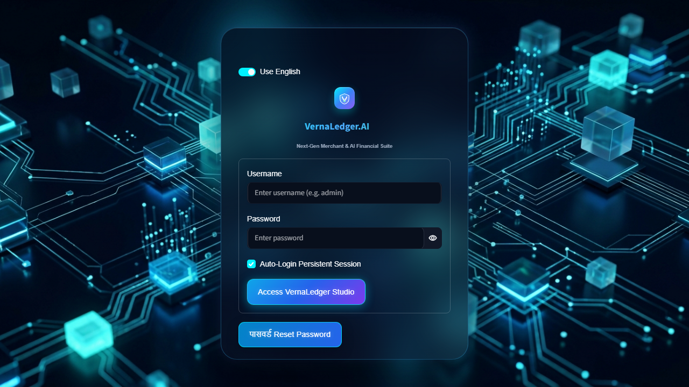
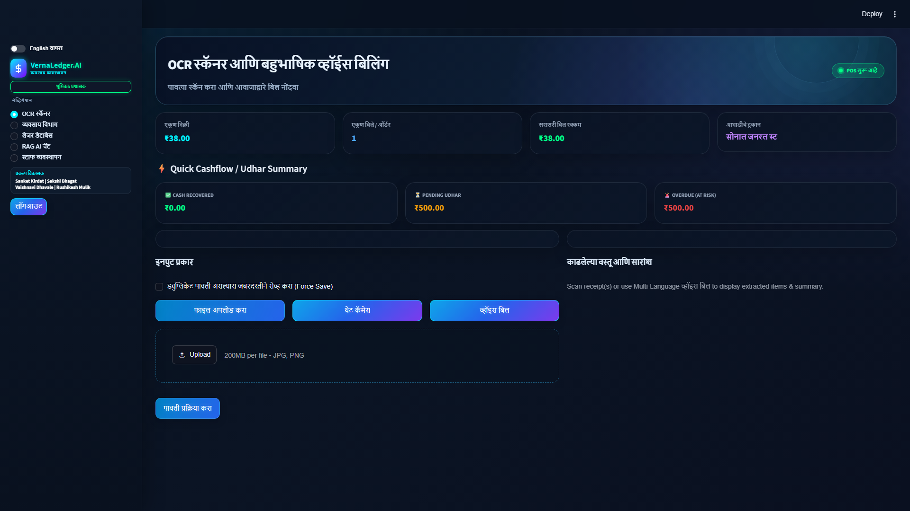
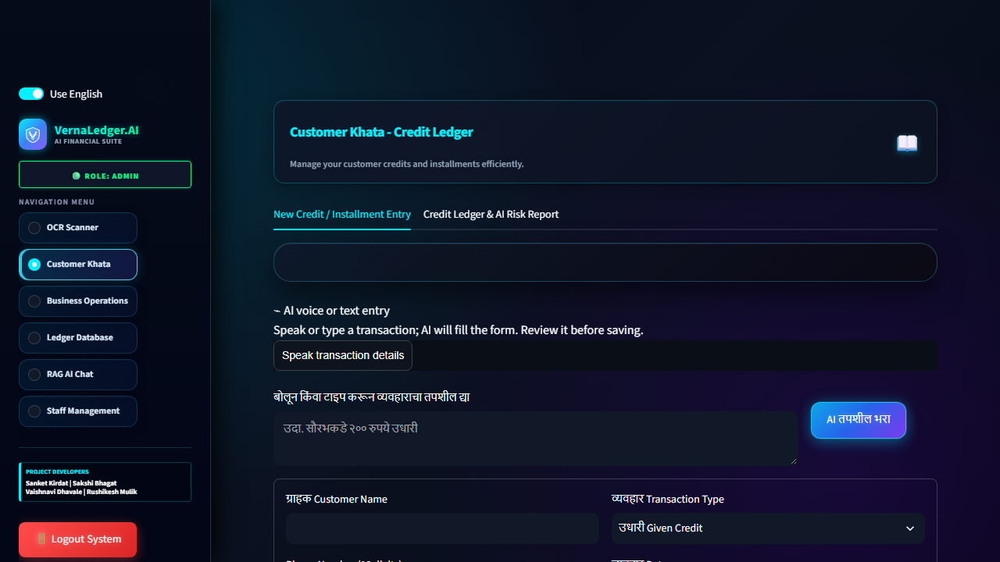
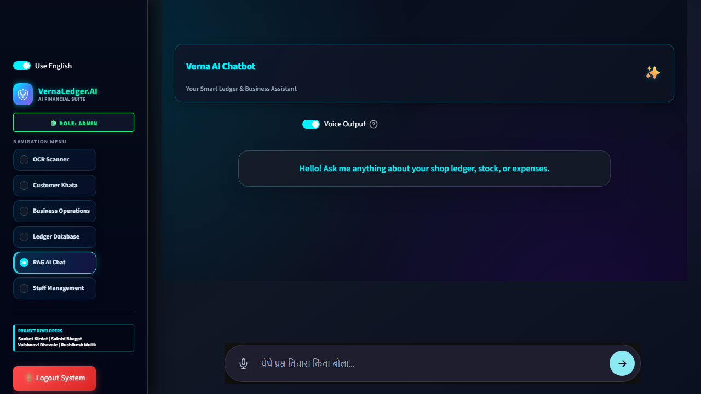
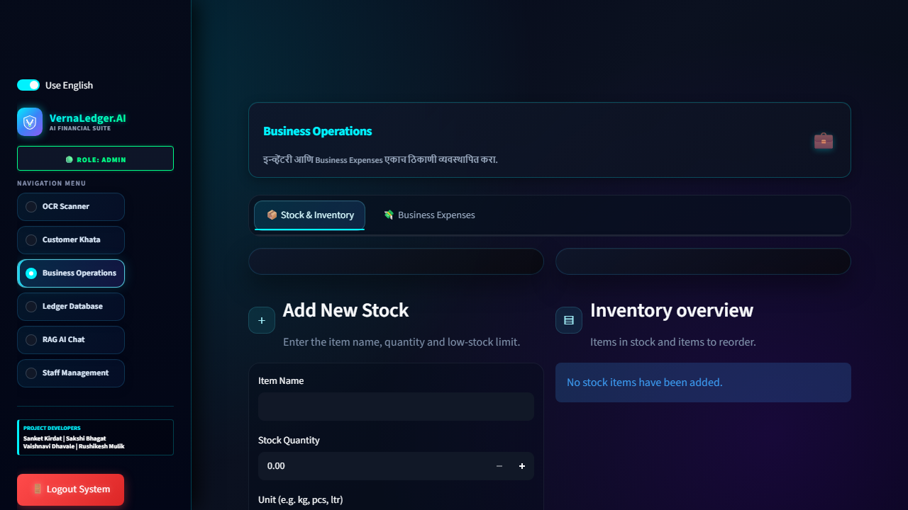
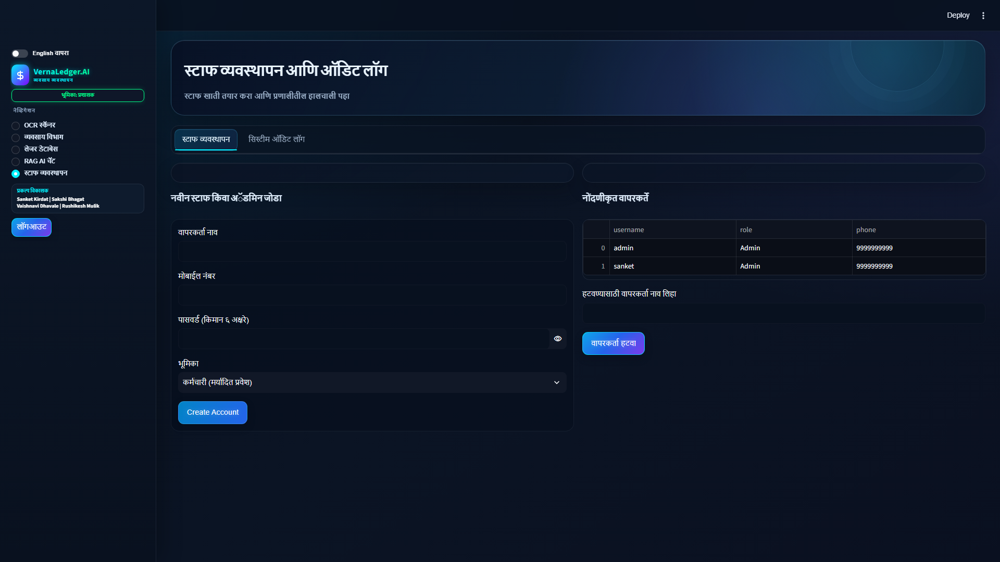
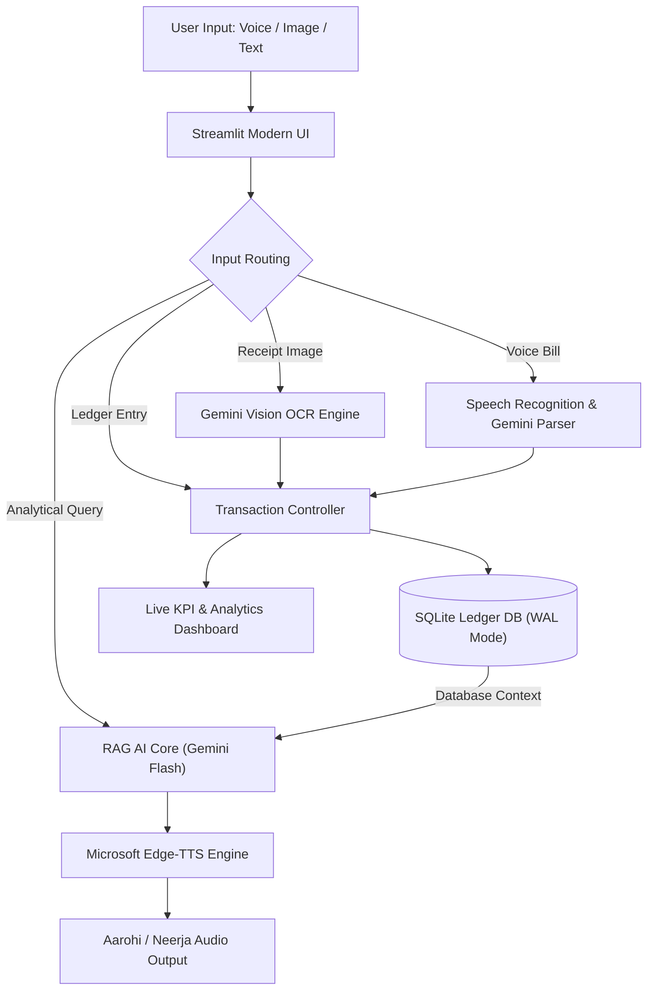

# 🤖 VernaLedger AI (व्हर्ना लेजर ए आय)

[](https://vernaledger-ai.streamlit.app)


-003B57?logo=sqlite)


> **Next-Generation Vernacular Financial Assistant & Intelligent Khata Ledger for Indian Retailers, Kirana Stores, and MSMEs.**

---

## 🌟 Overview

**VernaLedger AI** bridges the digital divide for small Indian businesses by providing an intuitive, multilingual, and voice-enabled financial ledger system. Built specifically for the Indian commerce ecosystem, it understands handwritten regional receipts (Marathi, Hindi, English), processes spoken voice bills, manages customer credit (*Udhaari*), predicts inventory reorders, and answers business queries in real-time through an intelligent Context-Aware RAG AI Chatbot.

---

## 📸 Visual Showcase

<div align="center">
  <table>
    <tr>
      <td width="50%">
        <h4 align="center">🔐 Secure Glassmorphic Login</h4>
        
      </td>
      <td width="50%">
        <h4 align="center">🧾 Smart OCR Receipt Scanner</h4>
        
      </td>
    </tr>
    <tr>
      <td width="50%">
        <h4 align="center">📖 Customer Khata & Passbook</h4>
        
      </td>
      <td width="50%">
        <h4 align="center">🤖 Context-Aware RAG AI Chatbot</h4>
        
      </td>
    </tr>
    <tr>
      <td width="50%">
        <h4 align="center">📊 Analytics & Financial Overview</h4>
        
      </td>
      <td width="50%">
        <h4 align="center">👥 Staff Roles & Audit Logs</h4>
        
      </td>
    </tr>
  </table>
</div>

---

## 🚀 Key Modules & Capabilities

### 1. 🧾 Smart Multilingual OCR Scanner
- **Regional Handwriting OCR:** Powered by Google Gemini Vision models to accurately extract item names, quantities, unit prices, and grand totals from handwritten or printed Devanagari (Marathi/Hindi) receipts.
- **58mm Pure Thermal Receipt:** Generates crisp POS slips ready for one-click printing or PDF download.
- **Smart Duplicate Prevention:** Automatically checks the database to prevent duplicate entries of the same bill.
- **One-Click Batch Inward:** Add all scanned receipt items directly into the shop's live inventory with a single tap.

### 2. 🎙️ Multi-Language Spoken Voice Billing
- **Hands-Free Billing:** Speak transaction details naturally in Marathi, Hindi, or English (e.g., *"रमेश कडून २ किलो साखर १०० रुपये आणि १ लिटर तेल १५० रुपये"*).
- **Auto-Parsing:** Converts natural spoken audio into structured itemized billing records instantaneously.

### 3. 📖 Customer Khata & Credit Ledger (*उधारी खाते*)
- **360° Customer Profiles:** Track customer balances, phone numbers, transaction timelines, and aging risk.
- **Direct Payment Collection:** Record payments instantly with automatic ledger passbook entries.
- **One-Click WhatsApp Reminders:** Generate personalized payment reminder messages with pre-filled customer details.

### 4. 🤖 Context-Aware RAG AI Chatbot with Neural Voice Output
- **Live Ledger Knowledge:** Asks analytical questions directly about sales, pending credit, customer debts, and stock availability (*"आज किती उधारी येणे बाकी आहे?", "साखर किती शिल्लक आहे?"*).
- **Neural Voice Output:** Natural speech responses powered by Microsoft Neural TTS (`mr-IN-AarohiNeural` for Marathi, `en-IN-NeerjaNeural` for English) with tuned regional pronunciation.

### 5. 📦 Business Operations & Inventory Management
- **Predictive Reorder System:** Real-time low-stock alerts with auto-calculated wholesale reorder suggestions.
- **Expense Tracking:** Monitor day-to-day shop operational costs with category breakdowns.

### 6. 🔐 Staff Management & Enterprise Security
- **Role-Based Access Control (RBAC):** Separate interfaces and permission levels for Store Owners (`Admin`) and Cashiers (`Staff`).
- **Cryptographic Security:** Passwords hashed with salted `PBKDF2-HMAC-SHA256`.
- **Immutable Audit Trail:** Comprehensive activity logging for financial compliance.

### 7. 🌐 Seamless Bilingual Toggle
- Switch dynamically between **English** and **मराठी** across all screens, metrics, and thermal slips.

---

## 🛠️ Architecture & Tech Stack



| Layer | Technologies |
| :--- | :--- |
| **Frontend & UI** | [Streamlit](https://streamlit.io), Custom HTML5/CSS3 (Glassmorphism), Vanilla JS Components |
| **AI & Multimodal Vision** | [Google Gemini 2.0 / 1.5 Flash](https://ai.google.dev/) via `google-generativeai` |
| **Voice & Speech Synthesis** | Microsoft Neural [Edge-TTS](https://github.com/rany2/edge-tts) (`mr-IN-AarohiNeural`, `en-IN-NeerjaNeural`) |
| **Database & Persistence** | [SQLite3](https://sqlite.org) with Write-Ahead Logging (WAL) & automated snapshots |
| **Security & Validation** | `pydantic` schemas, PBKDF2-HMAC password encryption, Role-based guards |

---

## 💻 Local Installation & Setup

### Prerequisites
- Python **3.11+** (Tested on Python 3.11, 3.12, 3.13)
- Git
- Google Gemini API Key ([Get one free from Google AI Studio](https://aistudio.google.com/))

### 1. Clone the Repository
```bash
git clone https://github.com/sanketkirdat08-cmd/vernaledger-ai.git
cd vernaledger-ai
```

### 2. Create and Activate Virtual Environment
```bash
# Windows
python -m venv venv
venv\Scripts\activate

# Linux / macOS
python3 -m venv venv
source venv/bin/activate
```

### 3. Install Dependencies
```bash
pip install --upgrade pip
pip install -r requirements.txt
```

### 4. Configure API Keys
Create `.streamlit/secrets.toml` in the project root:
```toml
GEMINI_API_KEY = "your_google_gemini_api_key_here"
```

### 5. Run the Application
```bash
streamlit run app.py
```
Open your browser at **`http://localhost:8501`**.

---

## ⚡ Deployment on Vercel (Production Serverless SPA)

VernaLedger.AI features a production-grade **FastAPI Serverless Backend** (`api/index.py`) and a responsive **Cyberpunk Dark Glassmorphic SPA** (`public/index.html`, `public/style.css`, `public/app.js`), fully pre-configured for 1-click deployment on [Vercel](https://vercel.com):

1. **Push to GitHub**:
   Ensure all changes are pushed to your GitHub repository `vernaledger-ai`.
2. **Import to Vercel**:
   - Go to [vercel.com](https://vercel.com) and log in.
   - Click **"Add New..."** -> **"Project"**.
   - Select your `vernaledger-ai` repository and click **Import**.
3. **Configure Environment Variables**:
   - Expand the **Environment Variables** section.
   - Key: `GEMINI_API_KEY`
   - Value: `your_google_gemini_api_key_here`
4. **Deploy**:
   - Click **Deploy**. Vercel will automatically build the Python serverless API and serve the high-speed static frontend at `https://your-project.vercel.app`.

---

## ☁️ Deployment on Streamlit Community Cloud (Legacy)

1. Fork or push this repository to your GitHub account.
2. Sign in to [share.streamlit.io](https://share.streamlit.io/).
3. Create a new app:
   - **Repository:** `your-username/vernaledger-ai`
   - **Branch:** `main`
   - **Main file path:** `app.py`
4. Under **Advanced settings** -> **Secrets**, paste your API key:
   ```toml
   GEMINI_API_KEY = "your_google_gemini_api_key_here"
   ```
5. Click **Deploy!** 🚀

---

## 👨‍💻 Project Team & Credits

This project was developed by the Engineering Team at **Arvind Gavali College of Engineering, Satara (AGCE Satara)**:

* 🎓 **Project Guide:** **Prof. Kaisar Attar Sir** (*प्रा. कैसर अत्तार सर*)
* 💻 **Lead Developer:** **Sanket Kirdat** (*संकेत किर्दत*)
* 🛠️ **Developers:**
  * **Sakshi Bhagat** (*साक्षी भगत*)
  * **Vaishnavi Dhavale** (*वैष्णवी ढवळे*)
  * **Rushikesh Mulik** (*ऋषिकेश मुळीक*)
* 🏛️ **Institution:** **Arvind Gavali College of Engineering, Satara, Maharashtra**

---

## 📄 License

This project is developed for academic, retail empowerment, and research purposes. All rights reserved.

